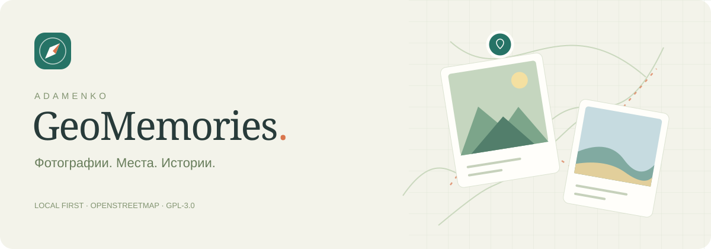

# AdamenkoGeoMemories

[](LICENSE)
[](https://github.com/AndreyAdamenko/AdamenkoGeoMemories/actions/workflows/ci.yml)


**Личный фотоатлас, который остаётся с вами.** AdamenkoGeoMemories превращает папку фотографий в карту воспоминаний: находите снимки по месту и дате, собирайте альбомы, добавляйте описания и теги. Каталог работает на вашем компьютере и может путешествовать вместе с диском.

| Возможность       | Что умеет приложение                                              |
| ----------------- | ----------------------------------------------------------------- |
| Импорт            | Чтение EXIF, даты и GPS; прогресс и возобновление                 |
| Карта и фотолента | Кластеры на OSM, плитка по видимой области, фильтры               |
| Истории           | Альбомы, подписи, теги для снимка или выделенной группы           |
| География         | Назначение точки на карте с сохранением исходных координат        |
| Переносимость     | Windows-комплект с Node.js, базой и миниатюрами на внешнем диске  |
| Резервные копии   | Согласованная копия SQLite и JSON-экспорт пользовательских данных |

**Оригиналы используются только для чтения.** Приложение не записывает EXIF, не переименовывает, не переносит и не удаляет исходные файлы. Все пользовательские изменения хранятся в SQLite внутри папки приложения.

## Запуск

Потребуются **Windows x64**, Git и Node.js с npm для первоначальной установки. Рекомендуется **Node.js 24 LTS**. Репозиторий содержит исходники; зависимости и готовый переносимый комплект в Git не хранятся.

Клонируйте проект и установите зависимости:

```powershell
git clone https://github.com/AndreyAdamenko/AdamenkoGeoMemories.git
cd AdamenkoGeoMemories
npm ci
Copy-Item config.example.json config.local.json
```

Откройте `config.local.json` и укажите свою папку фотографий. Например:

```json
{
  "sourceRoot": "D:\\Photos",
  "dataDir": "./data",
  "port": 3210,
  "importConcurrency": 2
}
```

Затем:

```powershell
npm start
```

Откройте **http://127.0.0.1:3210** и нажмите «Импортировать». Если зависимости уже установлены, достаточно `npm start`.

Для следующих запусков можно дважды щёлкнуть `start-server.bat`. Окно нужно оставить открытым; для остановки нажмите `Ctrl+C`.

Сервер слушает только `127.0.0.1`. Остановка — `Ctrl+C` в терминале.

Проект устанавливает собственный Node.js 24 в `node_modules/node`; системный Node.js менять не нужно. `npm run setup` завершает установку платформенных зависимостей под этим Node.js — это требуется, если системный npm работает на старом Node.js 18. Не используйте `npm install --omit=dev`: локальный runtime и сборщик нужны для запуска из исходников.

Карта загружает тайлы OpenStreetMap через интернет. Фотографии, база, миниатюры, шрифты и редактор работают локально; изображения никуда не загружаются.

## Как пользоваться

Высота съёмки читается из EXIF при импорте и показывается в карточке. Её можно исправить вручную или вернуть исходное значение; оригинал при этом не меняется. На карте значок самолёта обозначает высоту **от 6 000 м**; группа с такими снимками получает маленький значок самолёта. Это обозначение основано на высоте, а не на распознавании содержимого фотографии.

Для существующего каталога откройте **«Настройки и копии» → «Высота съёмки» → «Дополнить высоту»**. Отдельная операция читает только метаданные уже известных фотографий, без поиска новых файлов, полного импорта и пересоздания миниатюр. Прогресс сохраняется в базе порциями по 1 000 файлов. После остановки или перезапуска будут прочитаны только оставшиеся файлы; отсутствие высоты тоже считается проверенным результатом. Ошибки можно повторить отдельной кнопкой. Ручные поправки, координаты, описания, теги и альбомы сохраняются. Некорректные значения EXIF остаются в базе для диагностики, но не используются для значков. Полный импорт и дочитывание высоты запускаются по очереди.

1. Запустите импорт. Сначала идёт поиск файлов, затем чтение метаданных. Фотографии становятся доступны постепенно, не дожидаясь окончания всего импорта.
2. Переключайте вид: фотолента, фото рядом с картой, только карта. В режиме «Фото и карта» плитка показывает только снимки с координатами в видимой области карты и обновляется при её перемещении, масштабировании и изменении размера. Поиск, альбом, теги и остальные фильтры применяются вместе с областью карты. На карте нажимайте на группы маркеров для приближения, на одиночный маркер — для открытия снимка. Кнопка глобуса показывает мир.
3. Ищите по имени файла, папке, описанию и тегам. В фильтрах доступны папка, тег, даты и наличие координат.
4. Откройте фотографию, добавьте описание и теги через запятую. Координаты можно ввести числами или выбрать точку на карте. «Вернуть исходные» удаляет ручную поправку и снова использует GPS оригинала.
5. Для группы нажмите «Выбрать фото», отметьте снимки и выберите «Редактировать группу». Можно добавить/убрать теги, назначить общее место, добавить в альбом или заменить описание. Замена описания требует отдельной отметки в форме. Кнопка «Выбрать загруженные» относится только к уже загруженным карточкам.
6. Создайте альбом, затем добавьте в него выбранные снимки через редактор. У альбома свои название и описание. Из открытого альбома выбранные снимки можно убрать, сохранив сами фотографии и их подписи.
7. В «Результатах импорта» отображаются пустые, неподдерживаемые, отсутствующие файлы и ошибки чтения. Они не засоряют обычную фотоленту.
8. В «Настройки и копии» скачайте резервную копию SQLite или экспорт пользовательских данных в JSON.

Импорт можно остановить кнопкой в его окне. Уже обработанные записи сохраняются сразу. После остановки или перезапуска нажмите «Продолжить импорт» / «Сканировать снова»: приложение повторит обход и пропустит неизменённые файлы. Описания, теги, альбомы и ручные координаты сохраняются и при перечитывании EXIF изменённого файла.

## Настройка

Для запуска с переносного диска используйте установленную в архив папку `_GeoMemories`. Откройте [инструкцию переносимой версии](PORTABLE.md). Она содержит собственный Node.js и запускается без npm; каталог и кэш находятся рядом с программой.

По умолчанию используется папка `../Photos` рядом с проектом, порт `3210`, каталог данных `./data`. Для изменения скопируйте `config.example.json` в `config.local.json`. Относительные пути вычисляются от папки приложения:

```json
{
  "sourceRoot": "../Photos",
  "dataDir": "./data",
  "port": 3210,
  "importConcurrency": 2
}
```

Перезапустите сервер после изменения. `dataDir` должен находиться вне папки оригиналов либо в выделенной папке приложения внутри архива. Импорт исключает собственные папки программы и данных. В переносимом режиме `portable: true` корневой путь автоматически обновляется при переносе диска; относительные пути и ID снимков сохраняются. В обычном режиме не меняйте путь к архиву без необходимости.

Для разработки и тестирования также поддерживаются переменные окружения `PHOTO_SOURCE`, `PHOTO_DATA_DIR`, `PORT`. Прокси Vite в режиме разработки по умолчанию направлен на порт `3210`.

## Хранение данных и резервные копии

```text
data/
  catalog.sqlite        # каталог, EXIF, подписи, теги, альбомы, состояние импорта
  catalog.sqlite-wal    # журнал SQLite во время работы
  catalog.sqlite-shm
  thumbnails/           # автоматически создаваемые WebP-превью
  backups/              # согласованные копии базы, созданные через интерфейс
```

Миниатюры создаются по мере просмотра: маленькие до 480 px и большие до 1800 px, с учётом ориентации. Для RAW приложение пробует встроенное JPEG-превью. База работает в WAL-режиме. Во время работы делайте копию через интерфейс: она согласованно включает изменения из журнала. Для восстановления остановите сервер и замените каталог данных сохранённой копией; файл резервной базы должен называться `catalog.sqlite`, а старые `catalog.sqlite-wal` и `catalog.sqlite-shm` не должны оставаться рядом. Рекомендуется сначала переименовать старую папку `data` и создать новую с восстановленной базой. Превью можно восстановить автоматически.

JSON-экспорт содержит пути, подписи, теги, связи с альбомами и назначенные координаты. Это переносимый экспорт для внешних инструментов; импорт JSON в интерфейсе первой версии не реализован.

## Ограничения первой версии

- Индексируются изображения, включая JPEG, PNG, GIF, WebP, TIFF, HEIC и основные RAW. Реальный тип проверяет ExifTool, поэтому JPEG с неверным расширением тоже может быть распознан. Расширения файлов вне списка изображений не сканируются.
- Видео, музыка, XCF и содержимое ZIP/RAR не импортируются.
- Поддержка превью редких форматов зависит от Sharp и наличия встроенного JPEG в RAW. Если превью недоступно, запись и метаданные остаются в каталоге; оригинал можно скачать.
- Полная проверка целостности изображений при импорте не выполняется. Ошибки декодирования могут обнаружиться при создании превью.
- Дата берётся из EXIF, при отсутствии — из даты вида `YYYYMMDD` в названии папки. Дата из папки помечена в карточке; дата изменения файла не выдаётся за дату съёмки.
- Неполные GPS и координаты `0, 0` не размещаются на карте. Ручные координаты имеют приоритет над EXIF и хранятся отдельно.
- Неизменённые файлы определяются по пути, размеру и времени изменения. Для принудительного перечитывания файла с прежними размером и временем отдельной команды пока нет.
- Переименованный/перенесённый файл получает новую запись. Связь со старыми подписями автоматически не переносится. При полном успешном обходе отсутствующие файлы помечаются как недоступные; при недоступном диске или ошибках обхода массового помечания не происходит.
- Дубликаты не объединяются. Офлайн-подложка карты, маршруты поездок, распознавание лиц и автоматические предложения мест не входят в первую версию.
- Приложение рассчитано на один запущенный сервер и одного пользователя. Не запускайте `npm run import` одновременно с веб-сервером, использующим ту же базу.

## Разработка и проверка

```powershell
npm run dev       # API :3210 и интерфейс Vite :5173
npm run check     # TypeScript
npm run build     # production-сборка интерфейса
npm test          # интеграционная проверка на временных тестовых изображениях
npm run import    # импорт без веб-интерфейса, при остановленном сервере
```

Интеграционные тесты создают отдельные изображения во временной папке и проверяют GPS, географические фильтры (включая переход через 180°), кластеризацию, массовые изменения, откат невалидной операции, WebP-превью, резервную копию, перезапуск, перенос архива и контрольные суммы оригиналов. Тесты не изменяют пользовательский архив и рабочую базу.

Стек: Node.js 24, TypeScript, Express, встроенный SQLite, ExifTool, Sharp, React, Leaflet, Supercluster, Vite.

## Приватность

Фотографии, EXIF, точные координаты, подписи и миниатюры хранятся локально. Сервер слушает только `127.0.0.1` и предназначен для одного пользователя. Тайлы карты запрашиваются у OpenStreetMap по видимой области; фотографии и каталог на сервер карт не отправляются. Полностью автономная подложка карты не входит в эту версию.

В `.gitignore` исключены базы, кэш, локальная конфигурация, экспорты и отчёты аудита. Перед публикацией fork или сообщением об ошибке дополнительно проверьте прикладываемые файлы. Не открывайте локальный сервер в интернет без отдельной разработки аутентификации и контроля доступа.

## Участие и лицензия

Нашли ошибку или хотите предложить улучшение? Откройте [issue](https://github.com/AndreyAdamenko/AdamenkoGeoMemories/issues) или прочитайте [CONTRIBUTING.md](CONTRIBUTING.md). Изменения версий — в [CHANGELOG.md](CHANGELOG.md).

Copyright © 2026 AndreyAdamenko. Проект распространяется под **GNU General Public License v3.0 only** (`GPL-3.0-only`); полный текст — [LICENSE](LICENSE). Сторонние зависимости сохраняют свои лицензии: [THIRD_PARTY_NOTICES.md](THIRD_PARTY_NOTICES.md).
